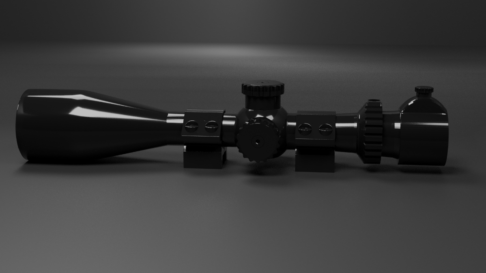
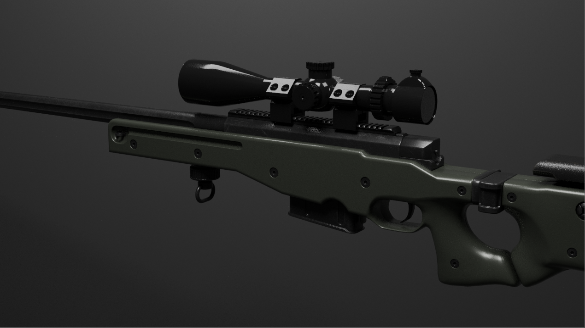

# Sniper Scope — Blender 3D Project

A detailed hard-surface 3D model of a sniper scope, created in Blender with a focus on mechanical details, reflective black materials, and cinematic studio rendering.

## Project Gallery

### Standalone Scope Render

### Mounted Scope Render

## Overview

This project explores hard-surface modeling and product visualization through a detailed optical scope design. The model features a tapered objective housing, adjustment turrets, mounting rings, adjustment controls, and a glossy black finish.

The final scene uses studio lighting and reflections to emphasize the silhouette, surface finish, and mechanical components.

## Skills Demonstrated

- Hard-surface 3D modeling
- Mechanical detailing and geometric forms
- Material creation and reflective surface shading
- Studio lighting and composition
- 3D rendering

## Project Files

| File | Description |
|---|---|
| `Sniper_Scope.blend` | Blender source project |
| `Sniper-Scope-Image.PNG` | Main render |
| `Sniper-Scope-Image2.PNG` | Alternative render |

## Software

- Blender

## Author

**Gursehbaj Singh**

3D Modeling and Blender Artist
